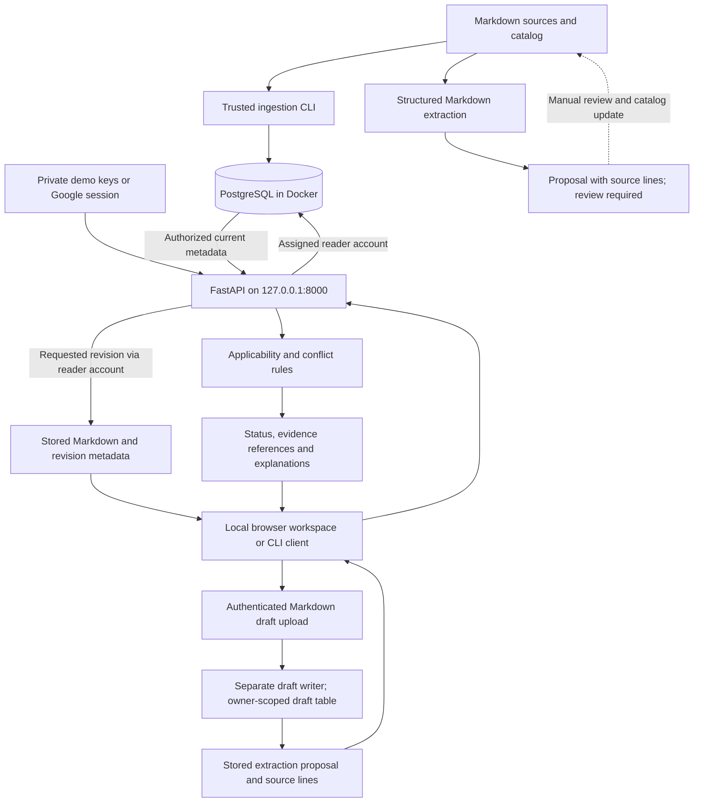

# Architecture and current scope

Runreviq is a local operational-evidence prototype. It selects applicable fictional runbooks and explains conflicts or uncertainty using explicit metadata. No LLM or cloud inference is involved.

## Storage and trust boundaries

`documents` stores each document's current revision and allowed roles. `document_versions` stores immutable revisions of content and metadata with checksums. PostgreSQL row-level security filters both tables through the actual reader login. The platform, security, and intern accounts can select permitted rows but cannot write or assume other reader roles.

The API derives the role from a demo bearer key or, in Google mode, from a verified Google subject and the current local role mapping. Google mode uses expiring server-side sessions and disables demo bearer access. See [Google login](google-login.md). The CLI's `--role` flag is a trusted operator test input, not authentication. The machine owner controls all demo keys and database passwords. Administrative database access and filesystem access remain trusted; public fictional fixtures are not confidential data.

Version rows reject ordinary updates/deletes, but administrators can bypass protections. Permission changes apply to historical revisions too. Repeating an unchanged revision is a no-op; content/metadata edits require a new revision. Stale imports cannot move the current revision backward. Removing a catalog entry does not revoke its stored copy.

PostgreSQL is exposed at `127.0.0.1:55432` and persists in a named Docker volume. The API runs directly in the project Python environment. pgvector is installed and tested, but no embeddings or semantic search are implemented.

## Selection and extraction

Selection filters permissions before inspecting metadata for explanations. It checks approval, service, exact numeric software versions, environment, verification, and required key-rotation context. Conflicts compare explicitly normalized `must`/`must_not` catalog rules. Conflict takes precedence over uncertainty, which takes precedence over selection. Every non-selected result has no recommendations.

Extraction reads explicit Markdown fields and proposes values with provenance. It cannot grant approval or permissions and never automatically modifies the catalog or database. General prose extraction, AI inference, and automatic proposal publication are future work.

## Implemented and remaining

Implemented: local Python setup, persistent PostgreSQL, revision ingestion, restricted readers, deterministic selection, an API supporting demo bearer keys or Google OIDC sessions, structured metadata proposals, actionable response fields, authorized historical document retrieval, a browser workspace with cited-passage viewing and private Markdown draft previews, automated tests, and required CI.

Remaining: production identity deployment, general account management, general document parsing, local LLM integration, vector retrieval, semantic contradiction detection, saved answers/audit history, background workers, and live service context. Conflict responses include manually authored, validated source-line quotations where provided; other claims can remain explicitly uncited. Automatic claim-to-passage alignment is future work.

See [setup](../SETUP.md), [API](api.md), [extraction](metadata-proposals.md), and [testing](testing.md).

## Draft storage boundary

Drafts live in `opslens.upload_drafts`, separate from published documents and versions. The dedicated `opslens_draft_writer` login can select and insert only draft rows, using an owner context derived by the server from the authenticated identity. It cannot read or write published evidence. Evidence readers cannot access drafts. The database owner and server holding the draft credential remain trusted; see [draft security boundaries](drafts.md).

Metadata review saves append a revision in `opslens.draft_reviews`, using parent-draft ownership, an expected revision, and a per-draft transaction lock. Original uploads/proposals are immutable to the application login. Validity feedback is separate from approval; neither drafts nor review snapshots feed the selector.

## Independent decisions

Submission records reference exact immutable metadata-review revisions. Owners explicitly share the source and selected snapshot with designated reviewers. A separate private identity allowlist gates reviewer API routes, and a restricted review database account reads submitted sources only. Immutable decisions record an opaque reviewer identity and comment; locks and unique keys prevent overwrites. Decisions do not affect published catalog status or selection. See [submission trust boundaries](submissions.md).

## Publication boundary

An operator-owned publisher allowlist protects a separate publishing API. A restricted database account reads approved snapshots and atomically writes published versions, current reading permissions, and an immutable publication receipt. Source-bound claims are manually attested; quotations and fingerprints are constructed from stored source lines. Selection remains deterministic. See [storage and trust boundaries](publication.md#storage-and-boundaries).

## Withdrawal and retained history

A separate append-only `document_withdrawals` table records retirement of specific published revisions. Selection excludes withdrawn current revisions; source reads retain current ACL enforcement and return a warning status. Publisher management exposes history and withdrawal reasons without rewriting stored sources. The shared ingestion/publication lock serializes withdrawal against replacement. See [the lifecycle boundaries](publication-management.md).

## Lexical passage retrieval

Question search now filters current authorized sources and applies the existing selector before ranking exact passages with PostgreSQL English full-text search. Authorization, lifecycle and content share a read-only database snapshot. Vectors are computed per request; no separately persisted search index is maintained. This is a small-corpus baseline, not vector retrieval or answer generation. See [search and evaluation](search.md).

## Java migration boundary

The production-workflow prototype remains implemented in Python. A parallel Java
selector and opt-in Google/demo authentication endpoints now live in `backend/`; they
now support opt-in JDBC selection/revision reads but do not serve the existing frontend. Java uses separate,
process-local sessions and reloads private role mappings on every identity request. See [migration plan](java-migration.md)
for implemented scope, parity checks, and pending authoring and retrieval stages. See [Java authentication](java-authentication.md) for its security boundary.

The JDBC adapter uses a fresh restricted reader connection and repeatable-read transaction
for each operation, validates stored integrity after RLS filtering, and executes no
schema or publication writes. See [Java persistence](java-persistence.md).

The Java draft adapter separately uses the restricted draft writer and transaction-local
owner scope. Advisory locks serialize quotas and review revisions under READ COMMITTED;
it cannot publish evidence. See [Java authoring](java-authoring.md).
