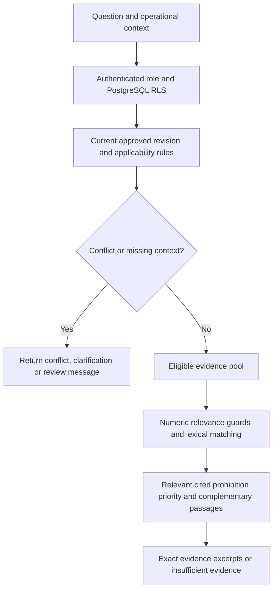

# Context-sensitive lexical retrieval v4

`postgres_english_context_v4` improves retrieval of authorized, applicable procedures and prohibitions. It produces exact excerpts, not generated answers. The v3 baseline and original source/question fixtures remain unchanged; separately versioned reports record the comparison.

## Eligibility before relevance



Authorization, service, environment, software version, required preconditions, verification, approval, current revision and withdrawal checks remain deterministic. Ranking runs after these checks, within the same restricted reader transaction. Text-derived heuristics cannot approve a source or grant access.

## HTTP status and other specifics

The former gate required every recognized numeric token in the question to appear in each candidate document. That excluded general diagnostic sources lacking literal `401`.

Now three-digit 100–599 tokens are treated as possible HTTP statuses only when the question also contains HTTP, status, response(s) or error(s). Other recognized numbers and uppercase identifiers remain exact. A version identical to the already validated software-version context need not be repeated in source text; other versions remain exact.

- A source mentioning a different status number without the requested status is rejected by the relevance guard.
- Recognized explicit restrictions such as “only for HTTP 503,” “HTTP 503 incidents only,” “restricted to HTTP 503,” and “not for HTTP 401” reject incompatible requests, even if the source also mentions the requested number elsewhere.
- Code-free sources may be ranked, but require at least two matching body terms beyond the HTTP/status/error vocabulary. “HTTP 503 errors” alone cannot pull in a general diagnostic source through the word “errors.”
- With at least two other diagnostic concepts, HTTP/code tokens no longer dilute relevance coverage after the numeric guard has run. Exact quotes retain their original codes and wording.

This is a conservative lexical guard, not comprehensive HTTP-scope understanding. Three-digit capacities can be mistaken for statuses; unfamiliar restriction wording may be missed; mixed-status documents remain difficult. No new status-scope metadata is inferred or treated as authoritative.

## Relevance and complementary evidence

Exact repetitions of the selected service and version are removed from scoring because applicability already checked them. Query scaffolding such as “which runbook,” “latest approved revision,” and “what did ... conclude” is reduced. Limited normalization relates error/failure, HTTP 4xx/5xx response/failure and token-validation/authentication-validation wording. It does not rewrite source text or establish semantic equivalence in all contexts.

General questions use a 35% weighted document-coverage floor and the existing 15% passage-body floor. Requests containing command(s), SQL, every, universal or exactly retain the stricter 50% document floor. This bounded request-vocabulary guard preserved the existing unsupported-command and universal-memory regressions during tuning; it is not a general detector of unanswerable questions.

Explicit clause separators (`while`, `whereas`, `as well as`, `and also`) allow a passage to satisfy a relevant clause, provided at least two clause terms occur in its body. Title matching alone cannot qualify evidence. After normal scoring, a passage scoring at least 30% of the best result may add a missing query concept; otherwise the 40% relative threshold applies. At most five passages are returned. These changes can also admit irrelevant material, as the probe precision regression demonstrates.

## Prohibitions and evidence authority

Only an existing manually encoded `must_not` claim on verified metadata can receive policy priority. Its validated citation must lie within the candidate passage, at least two normalized claim-action terms must match the question, and the passage must first pass the normal relevance gates. The multiplier is 1.25. An unrelated prohibition cannot qualify through its label alone.

This change introduces no automatic evidence-role assignments or new role schema. Reviewed claims provide the available authority for prohibition priority. Broader procedure/history/monitoring classifications remain future reviewed metadata; inferred labels would only be proposals. Structured conflict processing remains distinct from automatic contradiction extraction.

## Results and limits

| Measure | v3 | v4 |
| --- | ---: | ---: |
| External set: mean recall@5 across eight evidence-bearing role cases | 18.75% | 100% |
| External set: mean precision among returned passages | 25% | 100% |
| External set: correct withholding cases | 3/3 | 3/3 |
| External set: false-positive rate on withholding cases | 0% | 0% |
| Fixed 50 development questions: complete expected outcomes | 48/50 | 50/50 |
| Fixed 50: mean recall@5 | 93.75% | 100% |
| Fixed 50: mean precision | 37.24% | 38.28% |
| Eight-question probe: mean precision | 22.92% | 20.83% |

The original 30-case and additional 12-case suites remain complete on their expected outcomes. The eight-question probe still misses P02, “Which checks confirm that cache recovery is working?” (7/8 outcomes, 75% answerable recall). Its precision worsens because extra irrelevant excerpts enter result lists. Most returned passages in the larger development set still fall outside its strict relevance labels.

The external set comprises ten scenarios but eleven role cases because S10 is evaluated as platform and security. S02/S03/S10-platform are the three withholding cases. S06 is evidence-bearing for the monitoring reference; retrieving it does not answer current service health. Exact passage labels are a mechanical interpretation of the supplied expectations and require human review. The old baseline is scored against the same labels. See [external comparison](../datasets/external-validation/comparison-v4.json), [full v4 responses](../datasets/external-validation/results-v4.json), and [broader benchmark comparison](../datasets/benchmark/comparison-v4.json).

These questions influenced tuning and are now development data. The 100% external evidence metrics do not imply independently generalized accuracy, complete answers, correct current diagnoses or production readiness. No LLM, semantic model, generated explanation, live telemetry or stored-answer regeneration was added. Fresh independently reviewed questions are required for generalization claims.

## Reproduce

```sh
.venv/bin/python -m runreviq.evaluate_external > .local/external-v4.json
.venv/bin/python -m runreviq.compare_external .local/external-v4.json
.venv/bin/python -m runreviq.evaluate_search --suite realistic --report-only
.venv/bin/python -m runreviq.evaluate_search --suite paraphrase --report-only
RUNREVIQ_TEST_DATABASE=1 .venv/bin/python -m unittest discover -s tests -v
```

Keep reports private if using private source material. Evaluators use disposable databases; no migration, source re-ingestion, model download or paid service is needed. After merging, restart the API to load v4 (existing in-memory Google sessions will require sign-in again).
