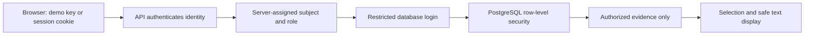

# Local evidence workspace

The FastAPI service serves the browser interface at `http://127.0.0.1:8000/`. HTML, CSS, and JavaScript are bundled in this repository, with no frontend build, external scripts, or model calls. Optional Google login contacts Google from the backend and redirects the browser to Google.

## Walkthrough

1. Complete [setup](../SETUP.md#local-browser-workspace), start the API, and connect using a local demo key or configured Google login.
2. Enter service, software version, environment, and known key-rotation state.
3. Read the result and next steps. Missing context offers a follow-up question; missing or unverified metadata shows review reasons. Insufficient evidence does not reveal restricted documents.
4. Conflicts show the opposing catalog rules and available exact source quotations. No recommendation is given while a conflict remains.
5. Open a stored revision or cited passage. The viewer shows the revision, current/historical label, recorded status, numbered source text, and stored checksum. Matching cited lines are highlighted. Readability does not imply applicability.

For platform / identity-service / production, version 2.4.0 with unknown rotation asks a follow-up; enabled rotation selects guidance. Version 2.5.0 with enabled rotation shows a conflict. Version 2.6.0 shows metadata needing review. The intern identity has insufficient authorized production evidence for 2.4.0.

## Authentication: which identity is making the request?

Optional [Google OIDC mode](google-login.md) verifies a Google identity and uses an HttpOnly server-session cookie. Reload restores a valid session; Disconnect revokes it. Roles are assigned separately by the operator. The following paragraphs describe demo-key mode.

The method is an opaque bearer API key, sent in the `Authorization: Bearer ...` header. The server reads its owner-only `.local/api-keys.json` configuration and maps a matching key to a subject and role. Keys are random and stored in plaintext in this Git-ignored, mode-600 file. SHA-256 digests are compared using a constant-time comparison during authentication; this is not hashed-at-rest key storage.

The browser validates the key with `/v1/me` and retains it only in JavaScript memory. It does not write the key to localStorage, sessionStorage, cookies, URLs, or source files. The input clears on submission. Reload, disconnect, page exit, or an authenticated 401 clears access and displayed evidence. Late responses from an old session are discarded. The application requests autocomplete off; browser/password-manager behavior remains outside its control.

Removing a key record revokes subsequent authenticated requests; already authenticated requests may complete. Keys have no expiry. This does not verify a human account: the local operator owns every demo identity. Demo mode has no password login or MFA; Google mode validates JWT ID tokens through OIDC and does not issue its own JWT access tokens.

## Authorization: which evidence can that identity read?

Role-based access control uses the server-assigned platform, security, or intern role. The request cannot choose its role. The API connects using the corresponding restricted PostgreSQL reader login. PostgreSQL row-level security checks the actual database login against current document permissions, including when historical revisions are requested. Reader accounts cannot modify evidence or assume other reader roles. The selector also filters roles before building explanations.

Missing and denied revisions both return 404. Access changes govern subsequent reads; previously delivered content cannot be retracted. The operating-system owner, ingestion CLI, and database administrator remain trusted.

## Browser boundaries

The public shell contains no credentials or evidence. Only three allowlisted assets are served. Evidence requests stay on the same origin and reject redirects. Responses use no-store, nosniff, no-referrer, and a restrictive Content Security Policy. Source text and quotations use textContent, so Markdown and HTML are displayed as text rather than executed. The UI clears a prior document before fetching another one.

This is a loopback-only prototype without TLS, rate limiting, production identity management, or comprehensive audit logging. Public fictional fixture files are not confidential. The interface can save private unpublished drafts. Publication requires a separate publisher capability; it records a publication receipt and explicit reading permissions. Independent submission decisions require separately assigned reviewer authority. There is no general chat, AI generation, semantic search, or automatic remediation.

## Appearance

The header provides System, Light, and Dark themes. System follows the operating-system color preference, including changes while the page is open. An explicit choice is remembered in browser localStorage under `runreviq-theme` (with a fallback to the previous `opslens-theme` preference); no credentials are saved there. If browser storage is blocked, the theme still works for the current page. Dark colors cover forms, status notices, conflict quotations, and citation highlights.

## Private drafts

After connecting, use **Add a document for review** to upload a Markdown file and preview extracted fields. **Load my drafts** lists only your own saved uploads. Preview source and quotations are plain text, and disconnect clears displayed drafts. See [the draft guide](drafts.md) for limits and setup.

**Your metadata edits** lets the owner correct extracted fields and save incomplete progress. Original extraction and source remain visible for comparison. A stale save displays a conflict and preserves typed input; load the latest draft after copying any changes you want to keep. Saving never approves or publishes.

## Submission review

Draft owners can explicitly submit a saved complete revision and check decision comments. The sharing notice explains reviewer access to the source and snapshot. **Submitted documents** provides a separate reviewer queue with approve/request-changes decisions. Reading roles do not confer review authority, and self-review is blocked. See [the workflow](submissions.md).

## Publisher workspace

**Publish approved guidance** checks separate publisher access, lists approved eligible submissions, and displays the exact source with line numbers. Publishers confirm metadata verification, explicitly select reading roles, and enter cited claims. Success shows a publication receipt; failed requests preserve input, and disconnect clears protected content. See [publication](publication.md).

## Manage published guidance

The publisher-only management section lists 50 documents per page, shows current reading roles and status, and opens revision history/source. Withdrawal requires a reason and explicit acknowledgment. Conflicts preserve typed input; permission loss clears protected views. Successful withdrawal clears the current browser’s old query results. The ordinary source viewer warns on withdrawn evidence and identifies superseded revisions. See [the workflow](publication-management.md).

## Ask a question

The context form includes an optional question. A nonblank question searches applicable source passages; blank input preserves the original selector. Search results show exact excerpts with document/revision/line labels and an **Open cited passage** button. Follow-up answers retain the question. Missing evidence, conflicts and review requirements still appear explicitly. These excerpts are not AI-generated answers. See [search limitations](search.md).
